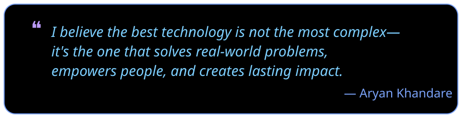

<div align="center">


<p>


</p>

<p>


</p>

</div>

---

# 🚀 About Me

<table>

<tr>

<td width="60%">

```yaml
Name          : Aryan Khandare
Education     : Computer Science Engineering (AI & ML)
Role          : AI Engineer | Full Stack Developer
Current Work  : Manufacturing Execution System (MES)
Specialization: Artificial Intelligence & Machine Learning
Location      : Maharashtra, India 🇮🇳
```

### 🌱 Currently Learning

- 🤖 Artificial Intelligence
- 🧠 Machine Learning
- 📱 Flutter Development
- ☁️ Cloud Computing
- ⚙️ Backend Development
- 🧩 System Design

</td>

<td width="40%" align="center">


</td>

</tr>

</table>

---

# 💼 Experience

## 🏢 AI/ML Intern

**Plasma Spray Processor Pvt. Ltd.**

📍 Mumbai, Maharashtra

🗓️ June 2026 – July 2026

### Responsibilities

- 📊 Developed Manufacturing Execution System (MES)
- 📈 Designed Production Dashboard
- 🔥 Built Production Analytics Dashboard
- ☁️ Integrated Firebase Database
- 📋 Reduced Manual Documentation
- 🤝 Worked with MIS Department

### Tech Stack

`React`
`Firebase`
`JavaScript`
`HTML`
`CSS`
`Google Sheets API`

---

# 💻 Tech Stack

## 👨‍💻 Programming Languages

<p align="center">


</p>

---

## 🎨 Frontend

<p align="center">


</p>

---

## ⚙ Backend

<p align="center">


</p>

---

## 🤖 AI / Machine Learning

<p align="center">


</p>

<p align="center">


</p>

---

## 🛠 Tools

<p align="center">


</p>

---

# 📊 GitHub Analytics

<div align="center">


<br><br>


<br><br>


</div>

---

# 🌐 Connect With Me

<div align="center">

<a href="https://github.com/AryanKhandare">

</a>

<a href="https://linkedin.com/in/YOUR-LINKEDIN-USERNAME">

</a>

<a href="mailto:your-email@gmail.com">

</a>

<a href="https://portfolio-link.com">

</a>

</div>

---

# 💭 Personal Philosophy

<div align="center">



</div>

---

<div align="center">

# 🐟 My GitHub Koi


### Growing with every contribution.

*Every commit adds to my journey.*

</div>

---


<div align="center">

## ⭐ Thanks for Visiting My Profile ⭐

### 🚀 Keep Learning • Keep Building • Keep Growing


</div>
